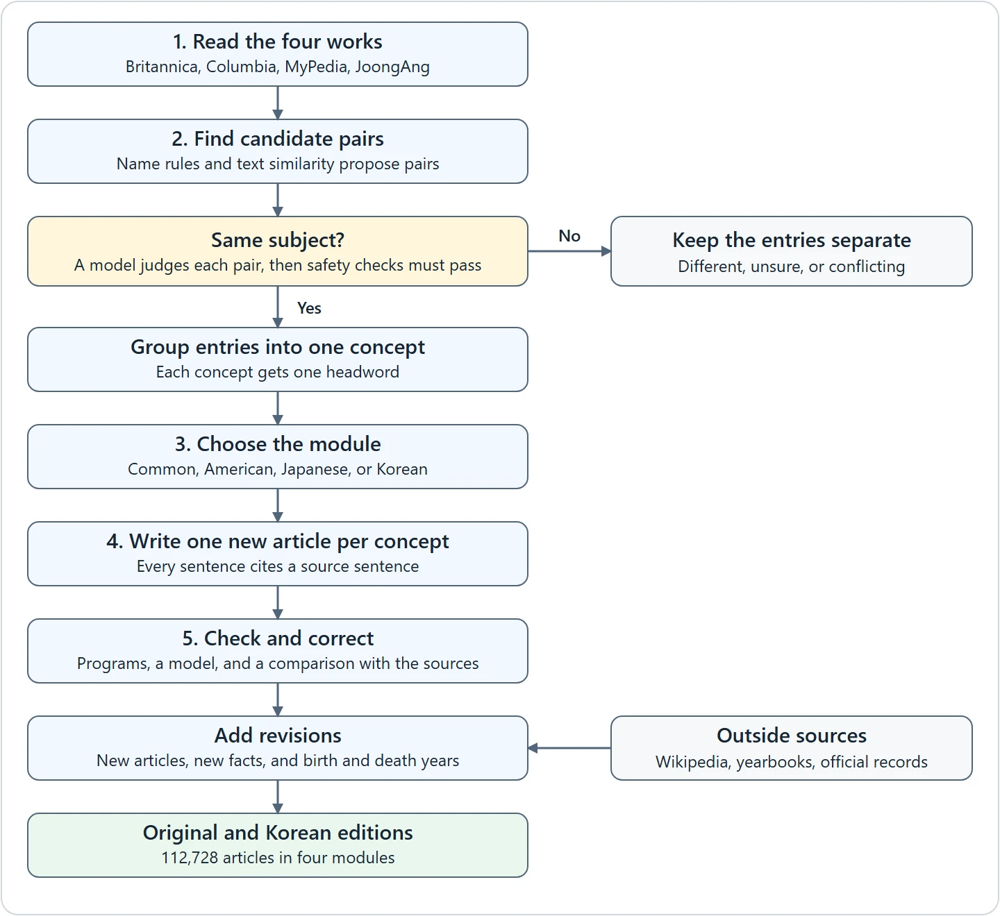

# How the book was built

Each step feeds the next. The work was mostly automatic, with human and model review at the points described below.

## 1. Reading the sources

| Work | Format and method | Records read | Source entries |
|------|-------------------|-------------:|---------------:|
| Britannica Concise | PDF with a text layer. | 28,293 | 25,288 |
| Columbia | PDF with an OCR text layer, plus the 2022 electronic edition (see below). | 51,190 (PDF only) | 41,551 (PDF only) |
| MyPedia | Dictionary file converted to plain text. | 142,319 | 53,828 |
| JoongAng '97 | WinHelp/MediaView file, decoded with a custom reader. | 46,746 | 44,464 |

Columbia exists as a scanned PDF (3,202 pages) with an error-prone OCR text layer, and as a 2022 electronic edition with 46,204 records. The table counts only the PDF. Each entry falls into one of three cases:

- **In both.** The electronic text replaces the OCR text, and the entry keeps its PDF ID.
- **Electronic only.** 8,358 records have no PDF entry. They are added on top of the PDF count as extra Columbia entries.
- **PDF only.** The OCR text is used with automatic fixes and review, but only when other works also cover the topic. A topic that rests on OCR text alone is left out.

Redirects and "See X" entries are not counted as source entries. The extracted text has small faults, such as a few wrongly detected headwords and lost characters. Pictures were also extracted from Britannica Concise, MyPedia, and JoongAng '97. They are not yet printed in the books.

## 2. Matching entries and choosing headwords

The four works often describe the same subject under different names. Cosmopedia groups those entries into one **concept** and prints one article for it. Each concept then gets one headword.

**Matching and merging**

1. **Clean.** Headwords were cleaned, but the original spelling was kept. Entries that only say "See X" became lookup names (aliases) for X.
2. **Find candidates.** Name rules and embeddings proposed pairs that might be the same subject. An embedding turns text into numbers so that similar texts can be found. Each embedding used the headword and the first 220 characters of the text.
3. **Judge.** A language model read up to 700 characters of each entry and answered `same`, `different`, or `unsure`. It judged 159,389 pairs.
4. **Guard.** A `same` answer was accepted only if the group stayed consistent. Two entries from the same work were never merged. A group was also blocked if any of its pairs had a `different` or `unsure` answer. 74,333 links passed.
5. **Group.** The links formed 130,303 concepts with 171,878 member entries. 133 groups were split because their people had different birth or death years.

This process can miss a merge. It is designed not to merge two different subjects.

**Choosing headwords**

- **English headwords** come from Britannica first, then Columbia. Concepts found only in MyPedia or JoongAng get an English headword only when it can be sourced or translated with confidence. Otherwise the concept moves to the Japanese or Korean module.
- **Person headwords** start with the surname, following library name authority files and language rules.
- **Korean headwords** use the official Korean rules for writing foreign words.
- When two different subjects share a name, the headword adds a short qualifier.

**Headword writing rules**

A headword is the common name or proper name that a reader would look up. Names were checked against Korean encyclopedias and Wikipedia titles. Wikipedia's own disambiguation brackets are not copied.

- **Facts stay in the text.** A product launch, a heritage listing, or a death is not added to the name unless it is an event of its own.
- **Same name, different subjects.** Keep the common name if the first sentence tells them apart. Add a qualifier only when it is needed.
- **Places.** A qualifier such as city or state is added only to separate places with the same name. Unique place names get no administrative unit.
- **Plants and animals.** Use the Korean name at the right rank (family, genus, or species). A confirmed scientific name is printed after the source mark. A name covering several species gets no single species' scientific name.
- **Events.** Use the common name. Add a country or year only when it is needed to identify the event.
- **People and terms.** Use the common Korean spelling for people, with the surname chosen by fixed rules. Technical terms use the widely used Korean name, but established forms such as RISC-V or WebRTC are kept as they are.
- **Headword versus lookup names.** Official names, abbreviations, other spellings, and original-language names go into the lookup names, not into the headword.

## 3. Choosing the module

Each concept goes to the first rule that fits:

1. A topic in Britannica, or in two or more of the four works, goes to Common. Columbia counts as one work, and Wikipedia does not count as a work.
2. A topic limited to Korea, Japan, or the United States, with text mostly about that country, goes to that country's module.
3. Any other topic that is clearly of worldwide interest goes to Common.

The source language alone does not decide the module. Later reviews moved entries that were not about Korea or Japan out of those modules into Common.

## 4. Writing the articles

Each concept got a new article, written in the language of its module from all of its source entries. Every sentence had to cite a source sentence. Programs checked the citations, numbers, and names, and rejected long copied passages. A fact that the sources state differently was left out. A model also reviewed each article for unsupported claims, changed meaning, contradictions, and missing core facts.

## 5. Review and correction

- 25,193 rewritten or merged entries were compared with the sources, and 1,978 errors were fixed.
- 750 merge pairs were checked again. 71 of them were split back into separate articles.
- Entries that shared one headword were resolved: merged when they described one subject, and given distinguishing headwords otherwise.
- Britannica page-boundary errors, person headwords, and Korean spellings of foreign names were corrected.

## 6. Updating facts since the source years

The four works end around 1995–2006. These steps brought selected facts up to date. Each change needed a source that describes the same subject, not only the same name.

- **Sources.** Offline Wikipedia snapshots from 2026 came first. Official statistics, laws, and organization records were used when Wikipedia was not enough.
- **Wikipedia additions.** Wikipedia supplied 578 new articles on important later subjects and 1,023 passages across 1,021 existing articles. Wikipedia was used as a source of facts only: its text is rewritten in new wording, not copied. Cosmopedia calls these W additions and marks the affected articles with `w`. The edition also has 796 body replacements and six article merges.
- **Yearbook review.** A **yearbook** is a year-by-year record of world events. One was written for each year from 1995 to 2025, using Wikipedia and official records. Topics from the yearbooks were compared with existing articles. Only subjects with lasting importance and good evidence were kept, which gave 59 new articles and 28 expanded ones.
- **People and offices.** New deaths, changes of office holders, and prize winner lists up to 2026 were added.
- **Organizations.** 50 company and institution entries were updated for renames, mergers, and closures. Each keeps its ID, and the old name points to the new headword.
- **Places.** Population figures and Japanese municipal mergers were updated. Each figure states its reference year.
- **Wording.** *JoongAng* occasionally says “our country” (우리나라). When the country is clear from context, the explicit country name replaces it.

### Revision policy

*MyPedia* covers a wide range of Japanese regions and companies and includes population and revenue figures that may become outdated over time.

Company entries are reviewed for their current operating status, mergers and acquisitions, and principal business activities. Standalone figures that are likely to become outdated are removed, while figures that help explain significant changes are retained together with their reference dates. Indicators showing changes in a company's core business or market position are tracked separately when they can be compared on a consistent basis.

Regular population updates primarily cover places with populations of at least 250,000. Exceptions may be made for small countries, territories, capital cities, and other important administrative centers. However, inclusion in the population update program does not automatically justify retaining a standalone population figure in an entry.

### Birth and death years

The Korean edition prints a person's birth and death years after the headword. A review of 29,633 people raised the number with both years confirmed from 15,319 to 21,961. The rest have one year, an estimate, an unknown year, or a disputed year.

- Korean people use the [Encyclopedia of Korean Culture](https://encykorea.aks.ac.kr/) first. Other people use Wikipedia articles about the same person.
- A year was added only when the source text states it for that person. Names alone never decided a match.
- Uncertain years stay marked as estimates. A missing death year does not mean that the person is alive.
- Entries about several people, such as a family, get no years.
