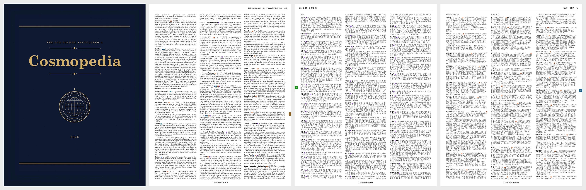

# Cosmopedia

Cosmopedia combines four encyclopedias: Britannica Concise, Columbia, MyPedia, and JoongAng. It uses Wikipedia to cover selected developments since those editions were published. Because of copyright, the original text of the four works is used only to select headwords. All article text is rewritten, and new and updated information is added through revisions. The Common and Local modules draw on English, Japanese, and Korean sources.

Read the [Preface](./preface.md) for the project's aims and editorial approach.

> “Maybe read through the condensed version of the Encyclopedia Britannica. I'd recommend that. You can always skip subjects ... just jump to the next one.” — **Elon Musk**, [Lex Fridman Podcast #252](https://www.youtube.com/watch?v=DxREm3s1scA)

- Common: topics that matter in many countries. Example: a world-famous person that both Britannica and Columbia describe.
- Local: topics that matter mostly in one country. Example: a Korean place that only JoongAng describes.
- Modular: a module collects only the entries of one region. Example: an American module, a Japanese module, and a Korean module. Each module is a separate part of the whole.

From left to right: the cover, a Common page in English, a Korean page, and a Japanese page. In the Common page, the marks M and J after a headword show which works describe the topic. The Japanese and Korean names follow in brackets.

**At a glance**

- 112,729 articles in four modules.
- Two editions: the **Original** edition (4,118 pages) keeps each module in its own language, and the **Korean** edition (3,748 pages) translates the Common, American, and Japanese modules into Korean.
- Pages are 241.4 × 312.4 mm with three columns. Each module has its own index of headwords and lookup names after its text.

## Why these four works

The goal is a quick look at the whole picture of knowledge. Each work has one job.

1. **Why a concise book**: general encyclopedias are too wide and too long for a quick check. The internet and generative AI already answer detail questions. **What is still hard is to see the whole picture of fields we do not know. A one-volume encyclopedia does that.**
1. Longer and more complex articles also make it harder to manage **details** and follow **connections between related facts** across entries.
1. **Britannica Concise** gives the **Common view**. Britannica has been published in many languages (Japanese, Chinese, Korean, Turkish, Polish, Hungarian, Brazilian Portuguese, Spanish). It also influenced other encyclopedias, which were edited on their own (French, Greek). Britannica Concise is its short one-volume work.
1. **Columbia** fills in next to Britannica. It is a leading one-volume encyclopedia. Its preface calls it "the handiest one-stop, one-volume" reference. It gives a second **English** and **Western view**.
1. **MyPedia** and **JoongAng** add **Asia** and **Eastern view**. Britannica and Columbia alone are not sufficient to cover these perspectives.
 - **MyPedia** (Japanese): published by Heibonsha (平凡社). The 1931 Heibonsha Encyclopedia made 百科事典 the standard term meaning “encyclopedia” in Asia. Heibonsha is a leading encyclopedia publisher in Japan. Heibonsha is known for Tōyō Bunko (東洋文庫), a major collection of Asian classics covering the Islamic world, India, China, Korea, and other parts of Asia.
 - **JoongAng** (Korean): published by JoongAng Ilbo, a major Korean newspaper company. It contains about 47,000 headwords and about 6,000 audio-visual materials. It is strong in IT and technology, with entries such as "전기자동차" (electric car), "가상현실" (virtual reality), and "태양전지" (solar cell).
 - Some MyPedia and JoongAng entries go to the **Common** module. Reason: they add an **Eastern view** of global topics.

## Sources

| Work | Edition, publisher, and latest year found in source text | Source entries | Source cross-references |
|------|-----------------------------------------------------------|---------------:|-------------------------|
| Britannica Concise Encyclopedia (B) English | © 2006 Encyclopædia Britannica, Inc., Chicago Latest year: 2006 | 25,288 | About 76,000 printed references |
| The Columbia Encyclopedia, Sixth Edition (C) English | Ed. Paul Lagasse, Columbia University Press, © 2000 (PDF text: 2000; electronic reference, © 2022: about 2021) Latest year: 2000 (PDF); about 2021 (electronic) | 41,551 | About 62,000 (print scan estimate); 90,555 links (electronic) |
| 百科事典マイペディア, MyPedia (M) Japanese | Heibonsha (平凡社), 1998 Latest year: about 1995 | 53,828 | 192,733 links, excluding standalone redirects |
| 중앙 멀티미디어백과, JoongAng Multimedia Encyclopedia '97 (J) Korean | JoongAng Ilbo (중앙일보사), 1997 Latest year: about 1995 | 44,464 | 211,278 links in named entries |

"Source entries" excludes redirects and entries that only say "See X". The rules are approximate for Columbia and JoongAng, so their counts are estimates.

The years come from a random sample of 5,000 source entries per work (2026-11-12). The estimate excludes publication dates, planned events, and Wikipedia updates.

The marks `B`, `C`, `M`, and `J` after a headword identify the works that cover the topic. They do not imply that the sources agree on every fact. The lowercase `w` marks material based on Wikipedia. `U` marks new and expanded entries.

### Where to find each work

Open Library search supplied the ISBNs and work pages below.

| Work | Online version | Book info |
|------|----------------|-----------|
| Britannica Concise (B) | [Britannica](https://www.britannica.com/). The old Concise site is gone. | 2006 edition: [Open Library](https://openlibrary.org/works/OL19468954W), 2,115 pages, ISBN 978-1-59339-293-2 |
| The Columbia Encyclopedia, 6th ed. (C) | [Encyclopedia.com](https://www.encyclopedia.com/) | 2000 edition: [Open Library](https://openlibrary.org/works/OL17011918W), 3,156 pages, ISBN 978-0-7876-5015-5 |
| MyPedia (M) | [Kotobank](https://kotobank.jp/dictionary/mypedia/) | Latest edition: *MyPedia* (新装新訂), 1995, 1,653 pages, ISBN 978-4-582-09631-6. [Bibliographic record](https://www.books.or.jp/book-details/9784582096316) |
| JoongAng '97 (J) | No known online version. | Closest book: 《Eureka 중앙백과사전》 (1995), 2,243 pages. [National Library of Korea catalog](https://www.nl.go.kr/NL/contents/search.do?pageNum=1&pageSize=10&srchTarget=total&kwd=Eureka+%EC%A4%91%EC%95%99백과사전) |

### Works read but not used

Two more one-volume works were extracted and then left out of every module:

| Work | Edition, publisher, and book info | Scan used | Entries extracted |
|------|-----------------------------------|-----------|------------------:|
| Der Brockhaus in einem Band German | Jubiläumsedition 2005, 11th updated edition, F. A. Brockhaus, Leipzig and Mannheim 1,024 pages, ISBN 978-3-7653-1681-4. [Open Library](https://openlibrary.org/works/OL9093993W) | [Internet Archive](https://archive.org/details/derbrockhausinei0000unse), 1,030 PDF pages | 26,296 |
| El Pequeño Larousse Ilustrado Spanish | Larousse Editorial, Barcelona, 2019 per the Internet Archive record (the preface says the work began in 1912) [Open Library](https://openlibrary.org/works/OL43191211W) | [Internet Archive](https://archive.org/details/elpequenolaarous0000vari), 1,928 PDF pages | 73,364 |

They were left out for three reasons:

1. **Text quality.** Both are available to this project only as archived PDF scans of the printed books. The text layer comes from OCR (optical character recognition), so it has many reading errors. Some Larousse pages are cut off at the left edge, and some accents are lost. The extracted text does not reliably match what the book prints.
2. **Short entries.** Most entries are one or two lines long, so they add few facts.
3. **Overlap.** Most of their topics are already covered by the four works above.

## Modules and editions

Local (지역편) covers the American, Japanese and Korean modules.

Each module has its own body and its own index of headwords and aliases. Only the Common module starts with the preface and the source legend.

| Module | What it holds | Entries | New Updated | Words (Original) (Korean) | Pages (Original) (Korean) |
|--------|---------------|--------:|--------------:|----------------------------------:|----------------------------------:|
| Common | Topics of worldwide interest English | 70,960 | 542 21,566 | 6,686,874 4,347,122 | 2,867 2,516 |
| Japanese | Topics about Japan Japanese | 18,245 | 91 5,360 | 1,756,870 979,559 | 548 553 |
| Korean | Topics about Korea Korean | 17,119 | 107 3,225 | 739,056 739,056 | 409 409 |
| American | Topics about the United States English | 6,405 | 93 1,834 | 671,866 461,392 | 290 266 |
| **Total per edition** | | **112,729** | **833 31,985** | **9,854,666 6,527,129** | **4,118 3,748** |

**New** and **Updated** are cumulative counts for the current edition, measured against the original render inputs. **New** counts entries added since those inputs. **Updated** counts original entries that remain in the edition and differ in either language. Each article ID counts once in its current module, and the two counts do not overlap.

## Updates since the source years

The four works end around 1995–2006. Selected facts were brought up to date with new articles, new passages, and revised facts such as office holders, organizations, population figures, and people's birth and death years. The sources were Wikipedia, a set of world yearbooks written for 1995–2025, and official records. All of this material is rewritten in new wording, never copied. Articles with Wikipedia-based material are marked `w`, and new or expanded entries are marked `U`. See [Updating facts since the source years](./README.build.md#6-updating-facts-since-the-source-years) for details.

## Subject shares

This table is from before the final same-headword decisions and does not include the 578 new W entries. All PERSON entries count under **People**, regardless of field. Other entries are grouped by field:

- History and politics: history, politics and law, military.
- Science, medicine and technology: life science, physics and chemistry, mathematics, earth and space, technology, medicine.
- Religion, philosophy and thought: religion and myth, philosophy and thought.
- Arts, literature and music: literature, visual arts and architecture, music, performing arts and film, language.
- Economy, law and society: economy and business, society, education and psychology, daily culture, sports and games.
- Other: the model answered UNSURE.

| Subject | Common | Japanese | Korean | American |
|---|---|---|---|---|
| **People** | 28.4% | 16.4% | 20.7% | 49.1% |
| **Places and geography** | 16.9% | 24.7% | 11.1% | 35.4% |
| **History and politics** | 7.6% | 14.4% | 25.6% | 4.7% |
| **Science, medicine and technology** | 27.2% | 8.8% | 5.3% | 1.9% |
| **Religion, philosophy and thought** | 4.7% | 5.9% | 4.5% | 0.6% |
| **Arts, literature and music** | 6.8% | 13.0% | 18.3% | 2.2% |
| **Economy, law and society** | 8.4% | 16.7% | 14.4% | 6.1% |
| **Other** | 0.1% | 0.1% | 0.0% | 0.0% |

## Limitations and status

- Authority control relies on AI knowledge, supplemented by official terminology and rule-based audits, to ensure cross-translation consistency. Some animal and plant terms may not be accurate, but the original headwords are also provided.
- Similarity between entries is evaluated using embeddings, rule-based output checks, and LLM-as-a-Judge, with some human review.
- Automated release checks cover copied text, article coverage, and PDF navigation. They do not replace a full visual or translation review.

---

See [How the book was built](./README.build.md) for how the sources were read, matched, merged, rewritten, and updated.
